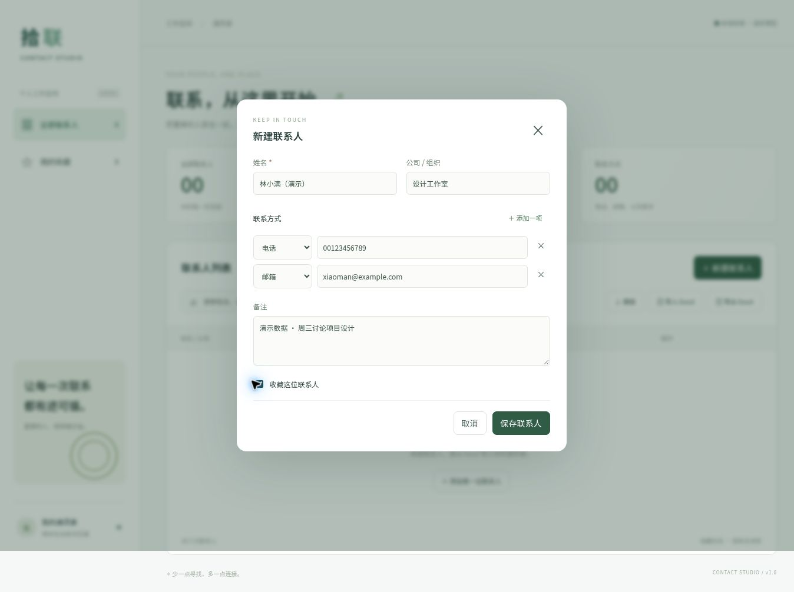
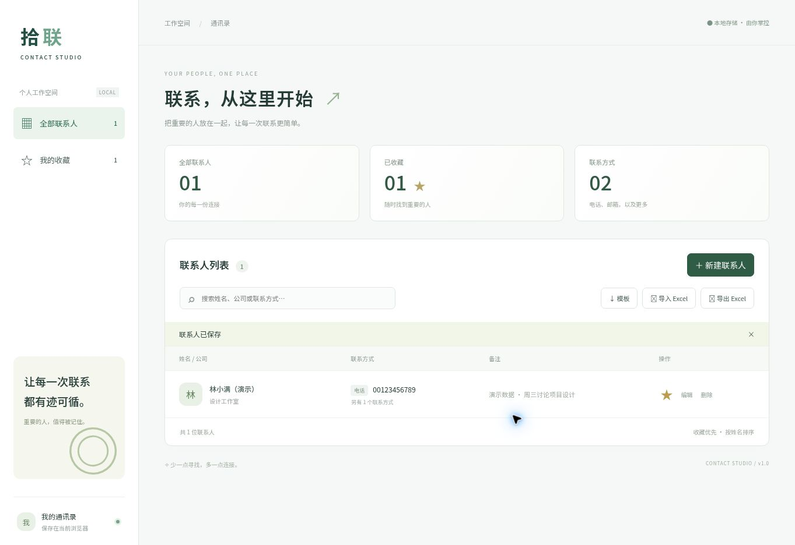
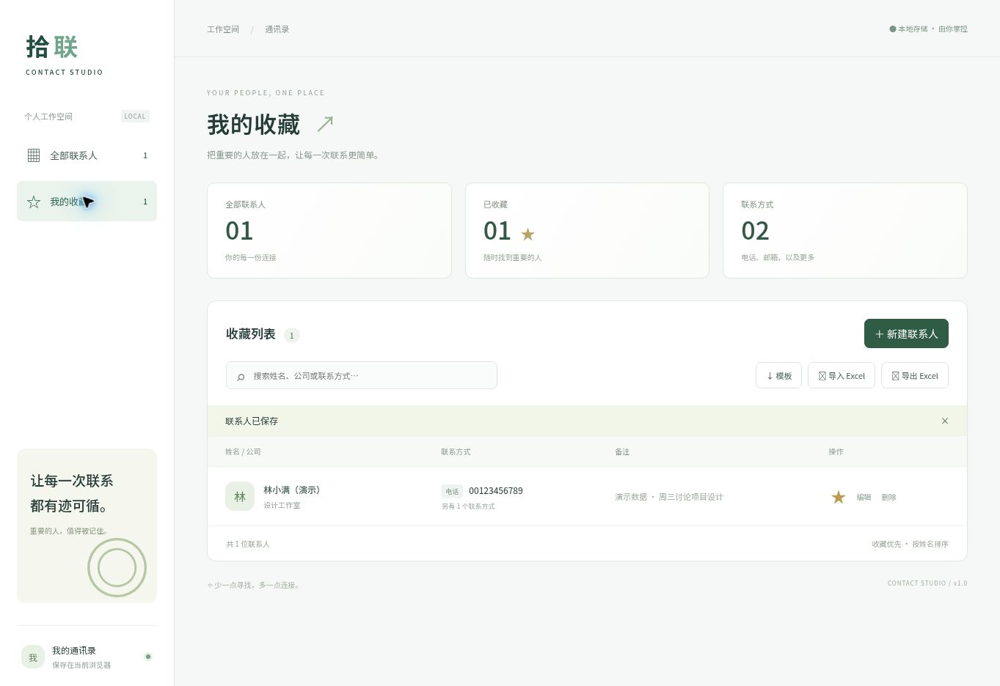
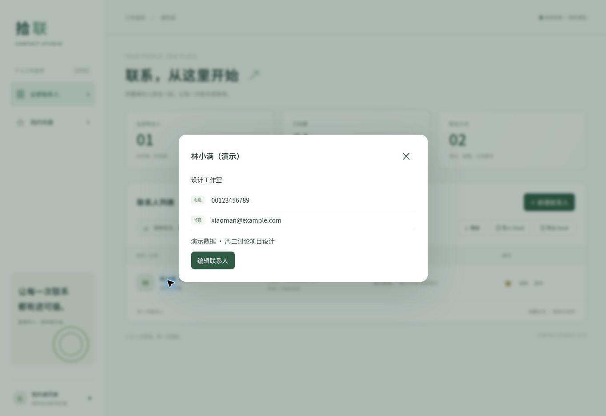
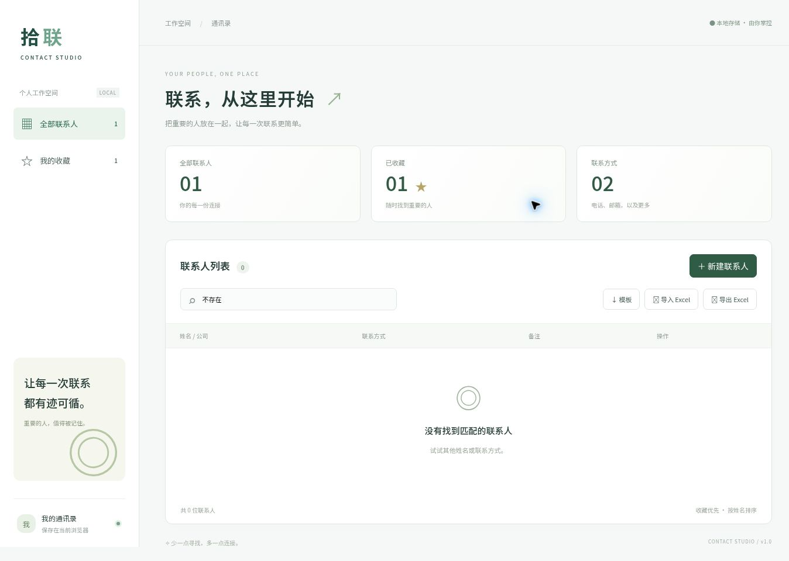
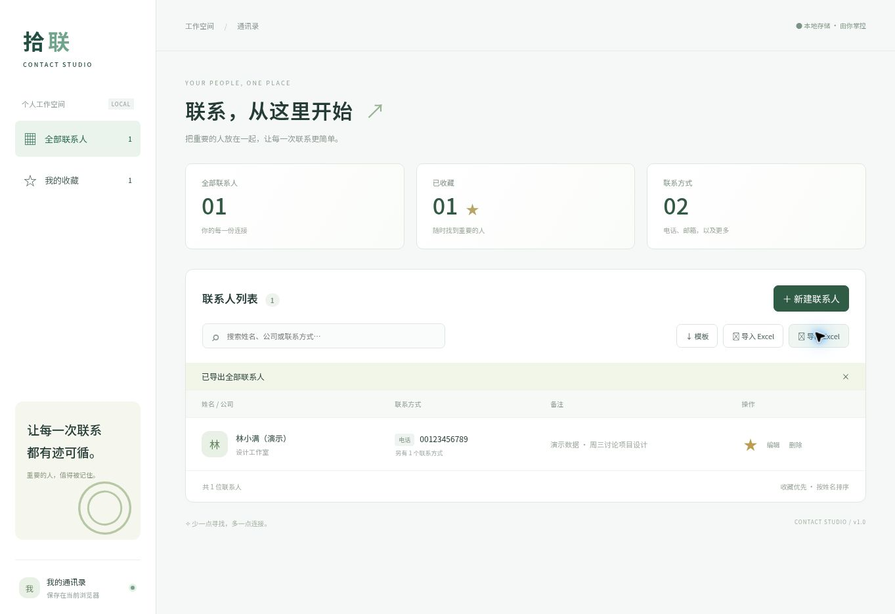
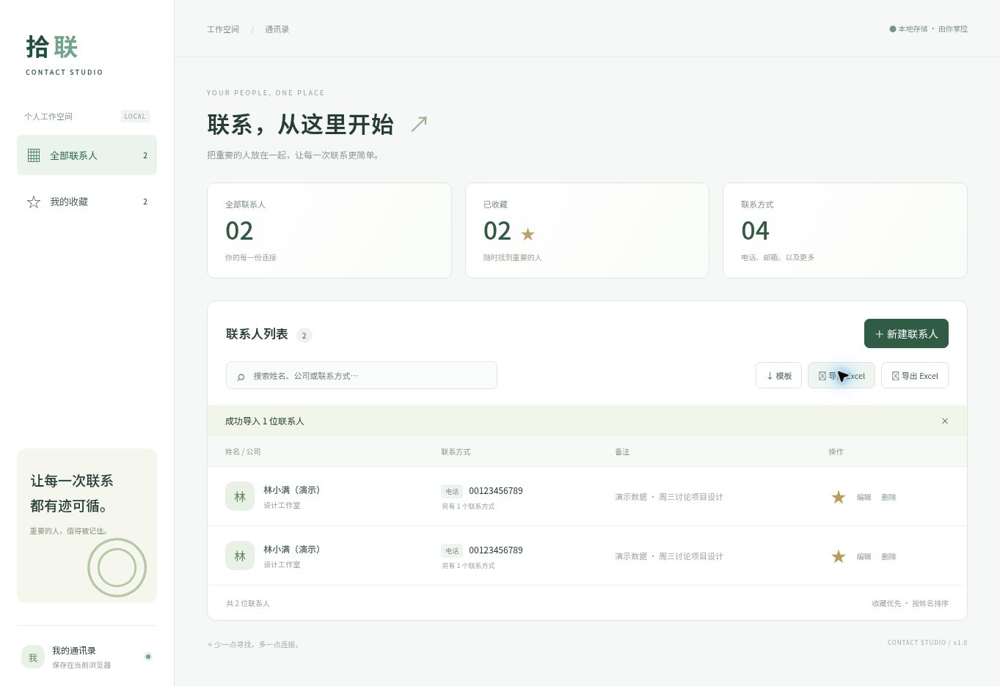

# 极限编程：拾联通讯录开发记录（提交前填写版）

| 项目 | 内容 |
| --- | --- |
| 课程 | 【填写课程名称及课程链接】 |
| 作业 | Extreme Programming / 极限编程【补充作业链接】 |
| 学生 | 【填写姓名、学号】 |
| 项目形式 | 个人项目 |
| 作业目标 | 完成收藏、多联系方式和 Excel 导入导出的通讯录，体验模块设计、编码、测试及 Git 交付 |
| GitHub 仓库 | https://github.com/dante991227-maker/contact-studio-xp |
| 代码规范 | https://github.com/dante991227-maker/contact-studio-xp/blob/feat/contact-studio/CODE_STANDARDS.md |
| 运行地址 | https://contact-studio-xp-20261117.bluishduet3.chatgpt.site （当前仅拥有者可访问，仍需提供教师可访问版本） |
| 版本 / PR | 【填写真实 Release 和 PR 链接】 |

> 老师提供的说明表原文尚未完整提供，此表暂用通用格式。本文为 AI 辅助项目的记录草稿；个人学习过程、耗时与反思应自行补充，不应直接作为未经核对的个人经历提交。

## 目录

- [1. 作业说明](#1-作业说明)
- [2. 模块设计](#2-模块设计)
- [3. 功能实现](#3-功能实现)
- [4. 运行与展示](#4-运行与展示)
- [5. Git 与版本交付](#5-git-与版本交付)
- [6. 个人职责与过程记录](#6-个人职责与过程记录)
- [7. PSP 表](#7-psp-表)
- [8. 评分项核对](#8-评分项核对)
- [9. 总结与不足](#9-总结与不足)

## 1. 作业说明

作业要求实现联系人收藏（25 分）、多种联系方式（10 分）、Excel 导入导出（25 分），并提供良好的页面样式（10 分）。博客及规范、实现思路和截图等材料占 30 分。云部署为额外 15 分，最终认定以教师要求为准。

项目为个人完成形式；无老师原始仓库，采用自建仓库、功能分支和向主分支发起 PR 的流程。

## 2. 模块设计

先明确数据模型与页面职责，再进行功能实现：

| 模块 | 输入 / 输出 | 职责 |
| --- | --- | --- |
| 联系人模型 | Contact、Method | 用统一结构表示联系人及多种联系方式 |
| 联系人界面 | 用户操作 → 新联系人数组 | 增删改查、详情、收藏、搜索 |
| 数据持久化 | 联系人数组 → localStorage | 浏览器本地保存与读取 |
| Excel 模块 | Workbook ↔ Contact[] | 单行单联系人导入导出及整批校验 |
| 验证模块 | 固定样例 → 断言结果 | 保证往返保真及异常输入处理 |

## 3. 功能实现

### 3.1 收藏联系人

Contact 包含 favorite 布尔字段。点击星形按钮通过不可变更新切换收藏状态，并立即保存。收藏视图筛选 favorite 为 true 的联系人，普通列表也优先展示收藏项。收藏数量从当前数据计算，避免维护多份状态导致不一致。

### 3.2 多种联系方式

每个联系人包含 methods 数组，每项有 type 和 value。类型支持电话、邮箱、社交账号、地址。同一种类型允许多项，表单可动态增加和删除。列表只显示第一项和其他项目数，详情页显示全部内容。

### 3.3 Excel 导入导出

导出 `.xlsx`，每位联系人一行，字段分别占列。同类多值保存为 JSON 文本数组，可以明确区分值边界，保留换行、逗号和前导零。使用空模板指导格式。

导入步骤为文件类型及大小检查、读取首张工作表、验证表头、逐行转换和校验、显示新增数量并确认，最后一次性写入。无效行会拒绝整批导入，不会留下部分记录。采用追加策略，重名和重复项仍会新增，界面确认明确提示该行为。

### 3.4 页面和本地数据

页面采用浅绿色侧栏、统计卡片、列表、详情和编辑弹窗。支持搜索和窄屏布局。所有数据保存在当前浏览器；没有跨设备同步和多人共享数据库。浏览器本地数据清除后需通过 Excel 备份恢复。

## 4. 运行与展示

```bash
npm ci
npm test
npm run build
npm run dev
```

实际浏览器运行截图（虚构演示联系人）：















测试记录见 [TEST_REPORT.md](TEST_REPORT.md)。

**完整运行视频：【补充本人连续录屏链接】**。如材料内提供截图演示视频，它只用于预览，不能替代要求中的连续完整运行视频。推荐按 SUBMISSION.md 的顺序录制新增、多联系方式、收藏、编辑、搜索、导出、导入和删除。

## 5. Git 与版本交付

- 仓库：【填写】
- Release：【填写】
- PR：【填写】
- GitHub 提交历史截图：【在上传仓库后补充实际截图】
- 各贡献者提交数：【按最终仓库实际统计填写】

统计示例：`git shortlog -sne --all`。助手生成的提交作者为 Project Assistant；这不代表本人独立手写完成，也不应修改作者或回填提交时间来伪造开发过程。本人后续理解、修改和测试应产生自己的真实提交。

## 6. 个人职责与过程记录

本项目无其他学生协作，不需要编造团队困难。学生职责覆盖需求理解、代码阅读与修改、功能验证、文档核对和最终提交；个人项目的学生分工比例为 100%，AI 辅助情况应按课程要求单独披露。

已在实现中处理的问题：

1. 多个联系方式放入一个 Excel 单元格可能存在分隔歧义：使用 JSON 数组保存每一类值。
2. 电话开头的 0 可能丢失：导出字符串单元格，提醒手动填写时采用文本格式。
3. 部分导入后才遇到错误可能导致数据混乱：先校验整份文件，再确认写入。
4. localStorage 写入失败可能造成界面与实际保存不一致：保存成功才更新页面数据。

【补充本人亲自调试遇到的问题、修改代码的内容及对实现的理解。】

## 7. PSP 表

单位：分钟。以下为空白记录表，请据实填写；事后估算应注明“回顾估算”，不可编造计时。

| PSP 阶段 | 任务 | 计划耗时 | 实际耗时 |
| --- | --- | ---: | ---: |
| Planning | 需求分析、评分项核对 | 待填写 | 待填写 |
| Development / Analysis | 数据模型与模块设计 | 待填写 | 待填写 |
| Development / Design | 页面与 Excel 格式设计 | 待填写 | 待填写 |
| Development / Coding | 代码阅读、编写与修改 | 待填写 | 待填写 |
| Development / Test | 自动测试及浏览器测试 | 待填写 | 待填写 |
| Reporting | 文档、截图及完整录屏 | 待填写 | 待填写 |
| Reporting | 版本发布、PR、博客与审核 | 待填写 | 待填写 |
| Postmortem | 复盘与改进 | 待填写 | 待填写 |
| 合计 | 各列求和 | 待填写 | 待填写 |

## 8. 评分项核对

| 评分项 | 分值 | 当前证据 / 待办 |
| --- | ---: | --- |
| Markdown、GitHub 和代码规范链接 | 10 | Markdown 和规范已有；补最终链接 |
| 思路、截图、个人职责 | 20 | 已有草稿和实际截图；补本人过程 |
| 页面样式 | 10 | React 页面和响应式样式 |
| 收藏 | 25 | 收藏、取消、筛选及持久化 |
| 多联系方式 | 10 | 动态数组、四种类型、同类多项 |
| Excel 导入导出 | 25 | 真正 .xlsx、模板、完整字段、校验 |
| 云部署（选做） | +15 | 部署后确认教师可访问；私有访问不应宣称已满足公开验收 |

额外硬性材料：GitHub 至少 3 次真实提交；提交历史截图和各作者统计；Release 和 PR；完整运行视频；本人 PSP；在截止前发布博客并等待审核。

## 9. 总结与不足

目前版本适合个人本地通讯录，核心需求已形成可运行实现。后续可增加重复联系人提示、撤销删除、分页及服务端同步。当前没有用户账号与云端联系人数据库；依赖第三方 Excel 库，导入应使用可信文件。

【补充本人学到的知识、能够解释的关键代码及下一步改进计划。】
